# Trivy Scanner (Wails v3)

Desktop app: enter a container image reference, and Trivy runs inside a local
Podman container (`docker.io/aquasec/trivy`). Results show in two panels:

- **Priorities** – the landing view: instead of 150 CVEs, a ranked shortlist (top 10 by default). Each finding gets a 0–100 score from a small explainable rule engine that combines
  CISA **KEV** (documented exploitation), **EPSS** (predicted 30-day exploitation probability), CVSS severity, attack vector/complexity/privileges/user interaction, and fix availability.
  Every card shows the points behind its rank and a plain-English attack-vector assessment. Tiers: Act now / Fix soon / Plan / Monitor (low-risk hidden by default).
- **VEX editor** – on any finding choose `affected`, `not_affected`, `fixed` or `under_investigation`, add a justification / impact / action statement (validated per the OpenVEX rules),
  and **Export OpenVEX** (v0.2.0). Assessments are stored in `<user config dir>/trivy-scanner/vex.json` per image repository, so they carry over to later scans and tags; resolved findings are hidden from the shortlist.
- **Compare** – pick an image repository and two tags (*Load tags* asks the registry via `podman search --list-tags`; you can also type tags or `sha256:` digests). Both are scanned and diffed docker-scout style:
  side-by-side severity counts with deltas, a verdict, vulnerabilities **added / removed / unchanged** with the reason (package upgraded, package removed/new, newly disclosed), and package **added / removed / upgraded / downgraded** with per-package vulnerability counts.
- **Vulnerabilities** – severity cards (click to filter), search, sortable table, click a row for details.
- **Dependencies** – an interactive force-directed **graph** of the SBOM dependency graph (canvas, no libraries): nodes are components (square = OS package, circle = library/app; fill = worst vulnerability in the package itself, ring = vulnerable only via a dependency; size = vulnerability count), arrows point from a package to what it depends on, laid out top-down from the image. Scroll to zoom, drag to pan or move nodes, double-click to fit. Defaults to vulnerable paths only; search, OS/Application filter, and *Focus* (selection ±1–3 hops) keep big images readable (max 400 nodes drawn). Click a node for its vulnerabilities and clickable *Depends on* / *Required by* lists.
- **SBOM** – CycloneDX components (name, version, type, license, purl) with search and type filters.

## Requirements
- Go 1.26+ (required by Wails v3 beta.34), [Wails v3 CLI](https://v3.wails.io) (`go install github.com/wailsapp/wails/v3/cmd/wails3@latest`)
- Linux: GTK4 + WebKitGTK 6 dev packages (see Wails docs); macOS/Windows: native webview
- `podman` on PATH (override with `PODMAN=/path/to/podman`) for real scans; not needed in demo mode

## Run
    go run .                                  # or: wails3 dev. Real podman, real scans
    go build -tags production -trimpath .     # production build, always real podman
    go test ./internal/...                    # replays the recorded fixtures, no podman needed

Every normal run, `wails3 dev` included, uses the real podman. Nothing is faked unless you ask for it.
Quitting (closing the window) stops a running scan and removes its container, following Wails' lifecycle guide: [`docs/lifecycle.md`](docs/lifecycle.md).

Running on a headless server that only has podman (no Go), reached from your browser over an SSH tunnel: [`docs/headless.md`](docs/headless.md).

### Fake data (tests and screenshots only)
Recorded Trivy output for two real Traefik releases lives in [`internal/trivy/fixtures`](internal/trivy/fixtures/README.md).
The Go tests replay it directly. To run the app itself on it, set a flag, in any **development** build (one without `-tags production`):

    TRIVY_SCANNER_FAKE_PODMAN=1 go run .
    TRIVY_SCANNER_FAKE_PODMAN=1 wails3 dev

A yellow banner says demo mode is on, the inputs are prefilled (`traefik:3.7.13`, Compare `3.7.13` → `3.7.16`) and EPSS/KEV lookups are turned off so the output is offline and deterministic.
Tags `3.7.13`, `3.7.16`, `3.7` and `latest` work; any other image gets an error listing what is recorded. Production builds do not contain the fixtures or any code that could replay them,
so the flag is ignored there (with a logged warning), and CI and the release workflow fail if a production binary ever contains demo-mode code.

### Screenshots
`scripts/screenshots.sh` rebuilds the app in headless server mode, runs it with `TRIVY_SCANNER_FAKE_PODMAN=1` and a throwaway VEX store, drives the UI with Playwright and rewrites `docs/screenshots/`.
It needs Go, Node 20+ and Playwright with Chromium (`npm install --no-save playwright && npx playwright install chromium`), and no GTK, podman or network.
The script also checks the data and that the dependency graph's layout stays finite, so a regression fails the run instead of producing a blank image.

Notes: the Trivy DB is cached in the `trivy-cache` podman volume. Trivy pulls the
target image itself from the registry; for private registries use *Options* to
pass credentials (via `TRIVY_USERNAME`/`TRIVY_PASSWORD` env, not argv).
Locally-built images that aren't in a registry are not scanned.

## Exploitation data
EPSS comes from `api.first.org`, KEV from CISA's JSON feed (cached on disk for 12h, stale cache used if offline). If a feed is unreachable the scan still works and the UI says which signal is missing.
Override with `TRIVY_SCANNER_EPSS_URL` / `TRIVY_SCANNER_KEV_URL` (mirrors, air-gapped use) and `TRIVY_SCANNER_VEX_FILE` (VEX store location).

## Updating
Release builds can update themselves: **Options → Check for updates…** fetches the latest GitHub release, verifies the download against its `SHA256SUMS`, and swaps the binary on **Restart & Apply**. It only runs when you click, needs the install directory to be writable (use your package manager for packaged installs), and is disabled in development builds. Details, limits and the release-asset contract: [`docs/self-update.md`](docs/self-update.md).

## CI and releases (GitHub Actions)
- **CI** (`.github/workflows/ci.yml`) – every PR and push to `main`: gofmt, `go mod tidy -diff` / `verify`, `go vet`, `go test -race`, a production-tag build that links GTK4/WebKitGTK, and a JS syntax check.
- **Security** (`security.yml`) – `govulncheck` and a Trivy filesystem scan when Go files or dependencies change, plus weekly (new advisories appear without code changes).
- **Tag and release** (`tag-release.yml`) – the normal way to cut a release. **Actions → Tag and release → Run workflow**: give a new tag (`v1.4.0`, `v1.4.0-rc.1`) or choose `patch` / `minor` / `major` to bump the latest `vX.Y.Z` tag. It tags `main` and then runs `release.yml`. Details: [`docs/releasing.md`](docs/releasing.md).
- **Release** (`release.yml`) – publishes a release for a tag. Run by *Tag and release*, or by pushing a semver tag yourself (`git tag v1.2.3 && git push origin v1.2.3`; `v1.2.3-rc.1` makes a pre-release). It re-runs vet/tests/govulncheck, builds a Linux amd64 binary, and publishes a GitHub release with the raw binary, a tarball, `SHA256SUMS`, generated notes and a build-provenance attestation (`gh attestation verify <tarball> --repo <owner>/<repo>`). Run it manually for a dry run that builds but does not publish.
- Dependabot keeps Go modules and the SHA-pinned actions current.
- The release layout doubles as the in-app updater's interface (raw binary + fixed-name `SHA256SUMS`): [`docs/self-update.md`](docs/self-update.md).
- Which ideas came from Wails' cross-platform build guide and `wails-build-action`, and what was left out: [`docs/ci.md`](docs/ci.md).

The release binary is built on Ubuntu 24.04 and links dynamically, so it needs GTK4 and WebKitGTK 6 (and a glibc at least as new as Ubuntu 24.04's) on the machine that runs it, plus `podman`.

## Screenshots
Generated by `scripts/screenshots.sh` from the recorded `traefik:3.7.13` / `3.7.16` scans (demo mode, hence the banner).

### Priorities
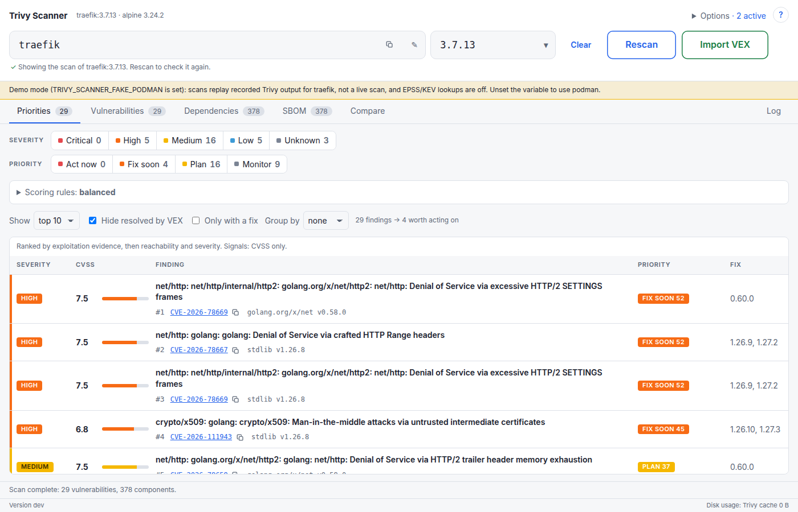
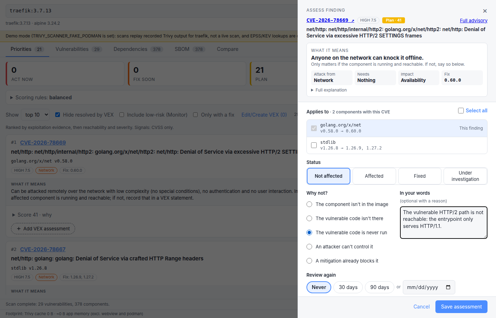
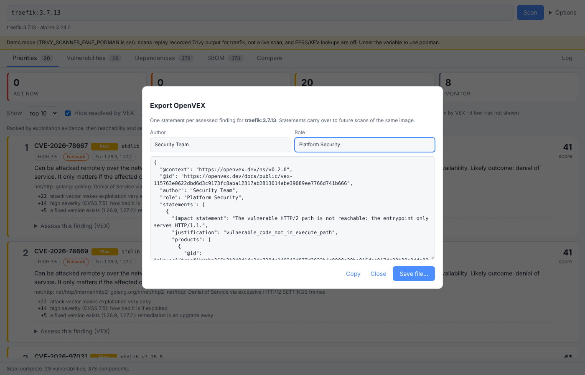

### Vulnerabilities
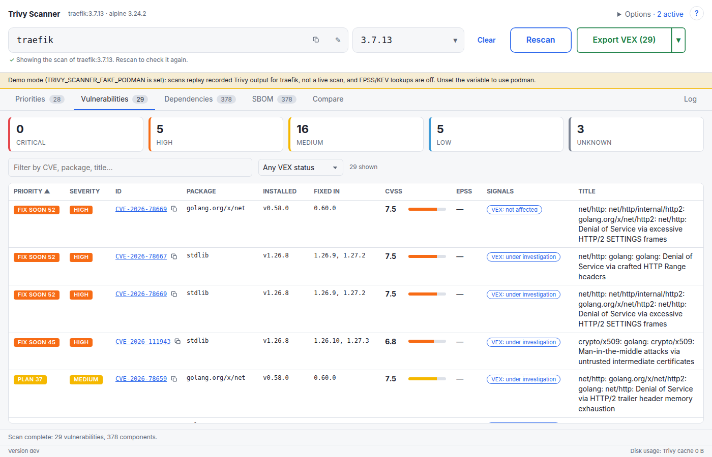
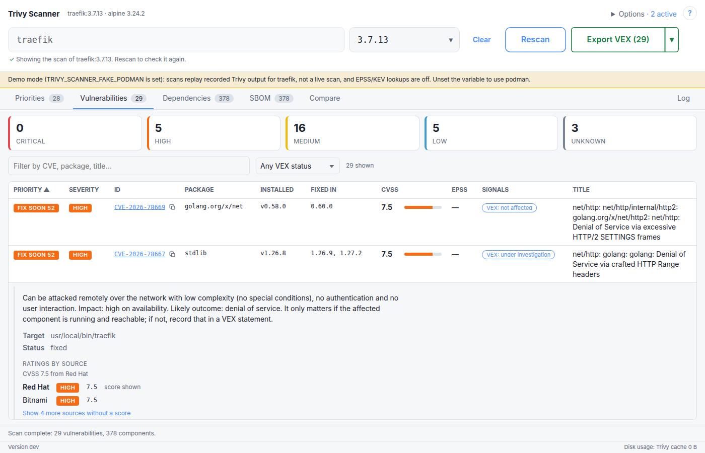

### Dependencies
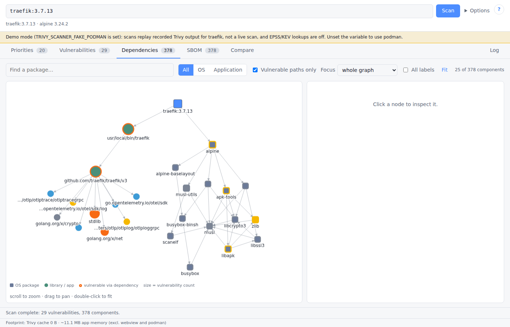
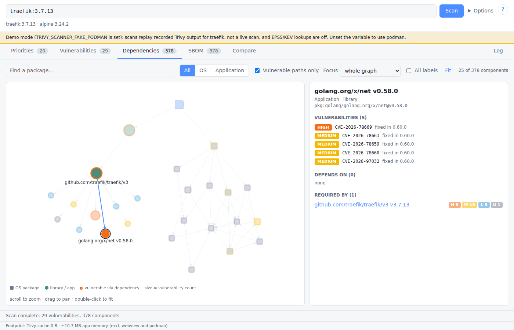
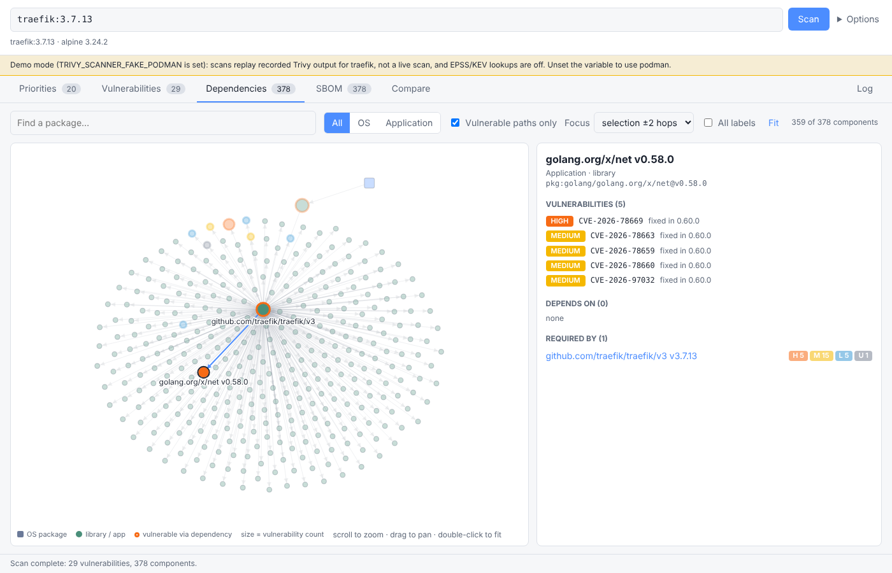
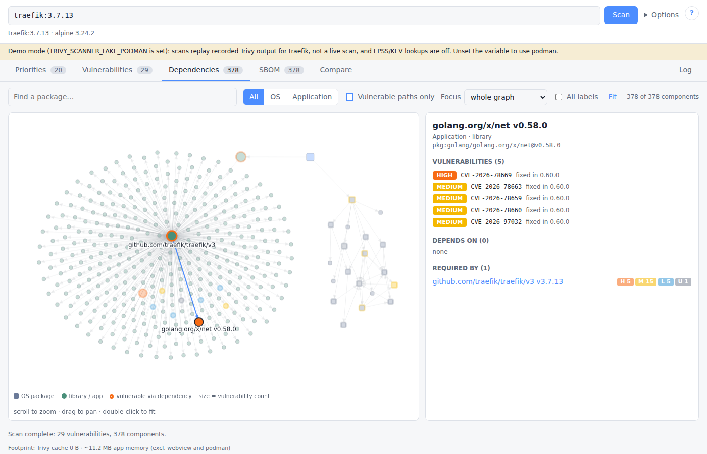

### SBOM
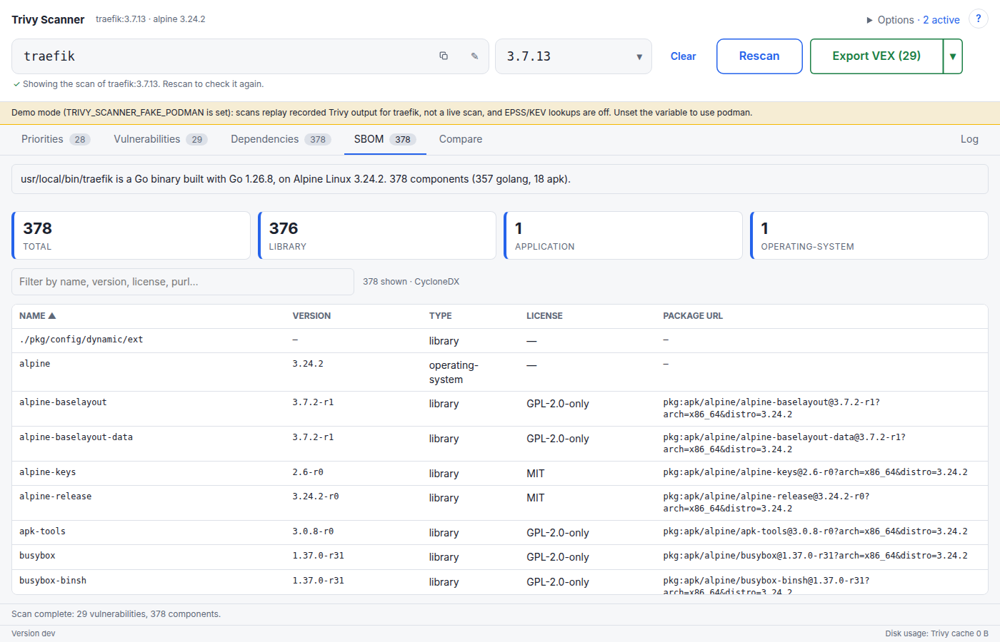

### Compare
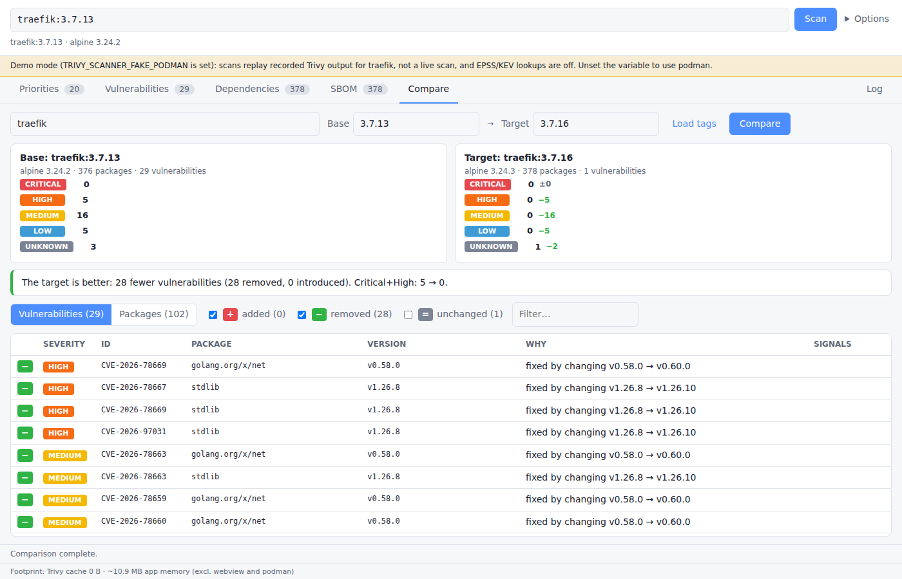
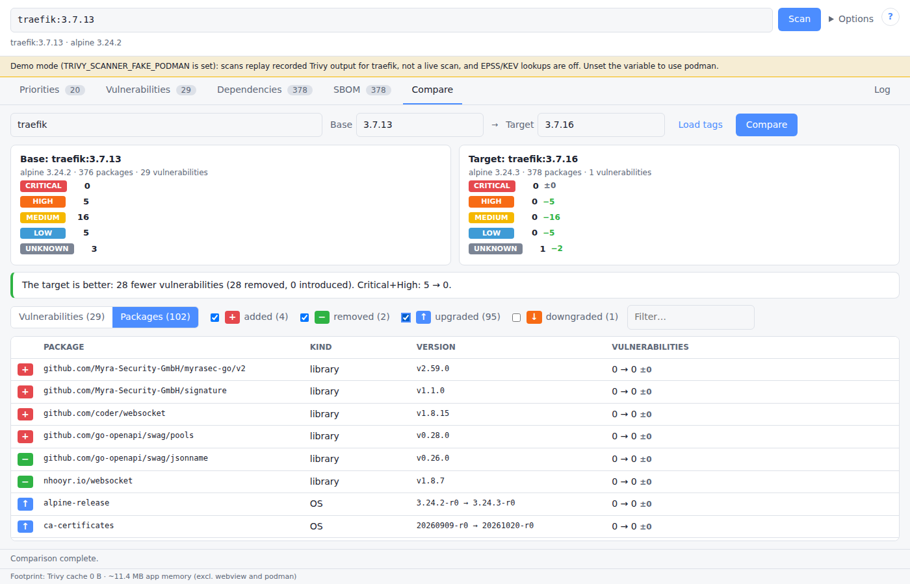

### Log
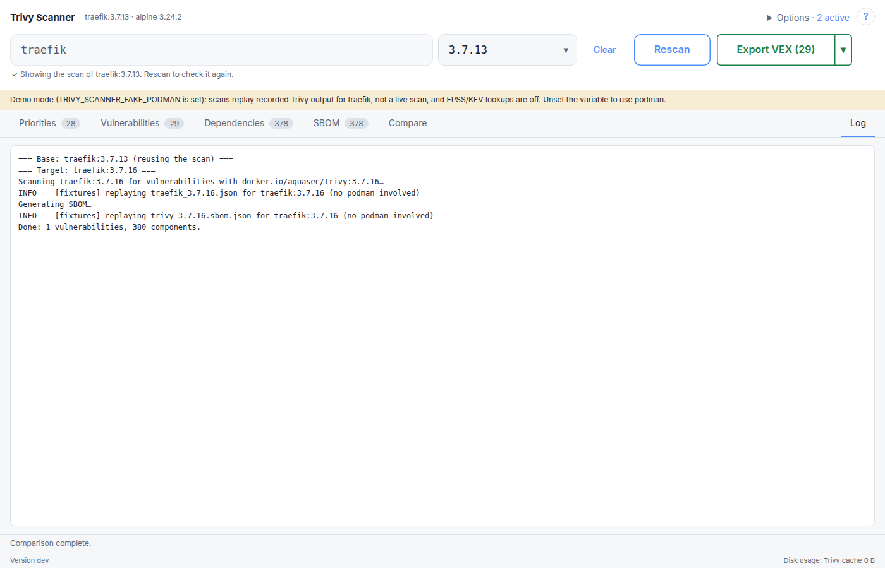
